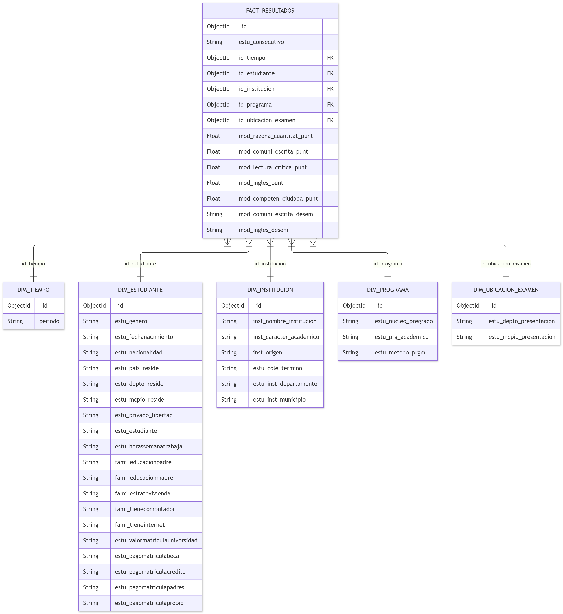

# proyecto-BI-pruebas-de-software
Proyecto final de pruebas de software que tiene como objetivo crear un proceso ETL para posteriormente presentar los resultados en un dashboard, facilitando la toma de decisiones.

## Stack tecnológico previsto

- Metodología de ciencia de datos: **CRISP-DM**.
- Base de datos: **MongoDB** como opción principal NoSQL. Apache Cassandra queda como alternativa para escenarios distribuidos de Big Data.
- Procesamiento y analítica: **Python**, pandas, NumPy, scikit-learn, XGBoost y LightGBM.
- Backend: **Python con FastAPI**.
- Frontend: **JavaScript/TypeScript, React y Vite**.
- Visualización: **Plotly, Chart.js o D3.js**.

## Configuración del entorno

### Backend

1. Copiar la plantilla de variables de entorno:

```bash
cp backend/.env.example backend/.env
```

2. Completar `backend/.env` con los valores del entorno local:

| Variable | Cómo obtenerla |
| --- | --- |
| `MONGO_URI` | `mongodb://localhost:27017/` si MongoDB es local; si es remoto, el líder del equipo comparte la URI. |
| `MONGO_DATABASE` | `SaberProDB`. |
| `NEON_AUTH_BASE_URL` | El líder del equipo la comparte por un canal privado. Debe terminar en `/auth`. |
| `NEON_AUTH_JWKS_URL` | El líder del equipo la comparte por un canal privado. Normalmente es `NEON_AUTH_BASE_URL` + `/.well-known/jwks.json`. |
| `DATABASE_URL` | El líder del equipo comparte la URL agrupada (pooled) de Neon PostgreSQL. |
| `APP_JWT_SECRET` | Generarlo localmente con el comando indicado abajo. |
| `FRONTEND_ORIGIN` | Origen del frontend, por ejemplo `http://localhost:5173,http://127.0.0.1:5173`. |

3. Generar `APP_JWT_SECRET`:

```bash
python -c "import secrets; print(secrets.token_hex(32))"
```

Copia el resultado en `APP_JWT_SECRET`. Debe tener al menos 32 caracteres.

4. Aplicar la migración de usuarios con `psql`:

```bash
psql "<URL_NO_AGRUPADA_DE_NEON>" -f migrations/001_create_app_users.sql
```

La migración crea el esquema `app`, el enum de roles y la tabla `app.users`.
Usa preferiblemente la URL no agrupada (`DATABASE_URL_UNPOOLED`) para tareas
administrativas.

**Importante:** `backend/.env` está incluido en `.gitignore`. Nunca confirmes
credenciales reales, cadenas de conexión ni secretos en el repositorio.

### Flujo de autenticación

El login se realiza contra el backend:

```http
POST /api/auth/login
Content-Type: application/json

{
  "email": "usuario@universidad.edu.co",
  "password": "contraseña-del-usuario"
}
```

La respuesta exitosa contiene el JWT de aplicación:

```json
{
  "access_token": "<jwt>",
  "token_type": "Bearer",
  "expires_at": "2026-11-08T23:59:59Z",
  "user": {
    "id": "<uuid>",
    "name": "Nombre del usuario",
    "email": "usuario@universidad.edu.co",
    "role": "Analista",
    "permissions": ["dashboard:read", "reports:read"]
  }
}
```

En las peticiones posteriores a endpoints protegidos se debe enviar:

```http
Authorization: Bearer <access_token>
```

El token dura ocho horas. `GET /api/auth/me` permite verificar el usuario y su
rol. `GET /api/auth/permissions` devuelve los permisos efectivos.

### Frontend

```bash
cp frontend/.env.example frontend/.env.local
cd frontend
npm install
npm run dev
```

El frontend queda disponible en `http://localhost:5173`. Si no se define
`VITE_API_URL`, Vite redirige `/api` al backend mediante el proxy configurado en
`frontend/vite.config.ts`. No expongas `DATABASE_URL` ni secretos en el
frontend.

### Smoke test autenticado

```bash
python scripts/smoke_test_api.py \
  --base-url http://localhost:8000 \
  --email usuario@universidad.edu.co \
  --password "contraseña-del-usuario"
```

También se pueden usar las variables `SMOKE_TEST_EMAIL` y
`SMOKE_TEST_PASSWORD`. Sin credenciales, el script solo ejecuta la prueba
pública `GET /api/health`.

**Usuarios de prueba:** los usuarios de los roles Administrador, Analista e
Investigador los comparte el líder del equipo por un canal privado. No están
incluidos en el repositorio.

## Frontend de autenticación (HU01)

La pantalla de acceso está implementada en `frontend/` con React, TypeScript,
Vite y la API de autenticación de FastAPI. Incluye guardas para `/dashboard`,
sesión persistida con expiración y menús/dashboards según el rol:
Administrador, Analista o Investigador.

```bash
cd frontend
npm install
npm run dev
```

En `frontend/.env.local`, define `VITE_API_URL` con la URL del backend
(por ejemplo, `http://127.0.0.1:8000`). El formulario siempre envía las
credenciales a `POST /api/auth/login`; no se conecta directamente a Neon Auth
ni deduce el rol a partir del correo. El backend debe tener
`FRONTEND_ORIGIN` configurado con el origen de Vite para permitir CORS.

Durante el desarrollo también puedes omitir `VITE_API_URL`: Vite redirige
`/api` mediante el proxy configurado en `frontend/vite.config.ts`. Nunca
expongas `DATABASE_URL` al frontend.

El backend expone `GET /api/health/neon`, que ejecuta `SELECT 1` contra
`DATABASE_URL` usando el driver `psycopg`. La URL agrupada (`DATABASE_URL`) es
la adecuada para las solicitudes web; reserva `DATABASE_URL_UNPOOLED` para
migraciones y tareas administrativas.

La migración [001_create_app_users.sql](./migrations/001_create_app_users.sql)
crea `app.users`, que relaciona cada usuario autenticado por Neon Auth con uno
de los roles de HU01 (`Administrador`, `Analista` o `Investigador`). Neon Auth
mantiene el correo, el hash de contraseña y las sesiones en `neon_auth`; la
aplicación no duplica esas credenciales. Para asignar un usuario después de
registrarlo en Neon Auth:

```sql
INSERT INTO app.users (id, email, role)
VALUES ('UUID_DEL_USUARIO_NEON', 'usuario@universidad.edu.co', 'Analista');
```

### API de autenticación

`POST /api/auth/login` recibe `email` y `password`, delega la validación de
credenciales a Neon Auth y exige que el usuario tenga un registro activo en
`app.users`. La respuesta contiene un JWT de aplicación firmado por el backend,
con `role`, `permissions` y vencimiento de ocho horas:

```json
{
  "email": "usuario@universidad.edu.co",
  "password": "********"
}
```

Las rutas de KPIs, filtros, predicción y salud de la base de datos exigen
`Authorization: Bearer <access_token>`. `GET /api/auth/me` valida el token y
`GET /api/auth/permissions` devuelve los permisos efectivos. Configura
`NEON_AUTH_BASE_URL`, `NEON_AUTH_JWKS_URL` y `APP_JWT_SECRET` con los valores
del proyecto Neon. El secreto de aplicación debe tener al menos 32 caracteres;
no lo incluyas en el repositorio.

Si se necesita conservar un proveedor de autenticación propio, también se
puede definir `VITE_API_URL` y exponer `POST /api/auth/login` con este contrato:

```json
{
  "email": "nombre@universidad.edu.co",
  "password": "••••••••"
}
```

La respuesta esperada es una sesión con `accessToken`, `tokenType`, `expiresAt`
(opcional, en milisegundos) y `user` con `id`, `name`, `email` y `role`.
Las peticiones protegidas pueden reutilizar `authHeaders()` para enviar
`Authorization: Bearer <token>`.

### Exportación gerencial del dashboard (HU29)

El dashboard permite descargar su vista activa como un reporte PDF desde el
botón **Exportar PDF**. La exportación incluye el título de la vista, el usuario
y rol de la sesión, los filtros activos y la fecha de generación.

La implementación se encuentra en `frontend/src/services/dashboardPdf.ts`.
`html2canvas` captura el contenido y `jsPDF` genera el documento en formato A4,
con paginación automática y pie de página. Las librerías se cargan únicamente al
solicitar la exportación para no aumentar la carga inicial de la aplicación.

### KPI de promedio global (HU11)

La vista **Indicadores KPI** de Analista consulta `/api/filtros/periodos` y
`/api/kpis/global`. Permite seleccionar un periodo y muestra el promedio global
de las cinco competencias, el total de registros y la variación porcentual
respecto al periodo anterior. Las peticiones incluyen la sesión autenticada
mediante `authHeaders()`.

### Histórico del puntaje global (HU15)

La vista **Indicadores KPI** incluye una serie anual del promedio global
Saber Pro. Los diez selectores consultan los valores distintos disponibles y
actualizan el gráfico al cambiar; el tooltip de cada punto muestra el promedio
y la cantidad de registros. El endpoint protegido es
`GET /api/graficas/historico` y admite `anio`, `departamento`, `municipio`,
`institucion`, `caracter_institucion`, `programa`, `metodo_programa`, `genero`,
`estrato` y `grupo_referencia`.

### Desempeño por estrato socioeconómico (HU17)

La vista también muestra los promedios globales por estrato (1 a 6) en un
gráfico de barras con el total de estudiantes por categoría. El endpoint
protegido es `GET /api/graficas/desempeno-estratos`.

### Comparativo por grupo de referencia (HU16)

La vista presenta un gráfico radar con las cinco competencias, comparando los
promedios de una institución seleccionada con el promedio nacional del grupo de
referencia elegido. Incluye leyenda, valores numéricos y tamaños de muestra. El
endpoint protegido es
`GET /api/graficas/comparativo-competencias?institucion=...&grupo_referencia=...`.

### Ranking institucional Top/Bottom (HU19)

La vista presenta rankings Top 10 y Bottom 10 por promedio global de las cinco
competencias, ordenados de mayor a menor, y permite alternar entre IES oficiales
y no oficiales. Los orígenes que comienzan por `OFICIAL` se agrupan como
oficiales; los que comienzan por `NO OFICIAL` como no oficiales. El origen
`REGIMEN ESPECIAL` queda fuera de ambas categorías. El endpoint protegido es
`GET /api/graficas/ranking-instituciones?tipo=OFICIAL` (o `NO%20OFICIAL`).

## Configuración local

Se recomienda ejecutar Python dentro de un entorno virtual aislado.

### Ejecutar el pipeline localmente

El comando siguiente reproduce las validaciones principales del workflow de
GitHub Actions: instala las dependencias, ejecuta los tests del backend y
compila el frontend.

```bash
npm run ci:local
```

Requisitos:

- Python 3.14 recomendado.
- Node.js 22 o superior y npm.
- Dependencias instalables sin secretos, ya que las pruebas actuales no
  requieren conexiones externas.

El pipeline local completo también puede ejecutarse paso a paso:

```bash
python -m pip install -r backend/requirements.txt
python -m pytest backend/tests
npm ci --prefix frontend
npm run build --prefix frontend
```

Para ejecutar el archivo `.github/workflows/ci.yml` con la misma sintaxis de
GitHub Actions, se puede usar `act` con Docker:

```bash
act push
```

### Windows PowerShell

```powershell
python -m venv .venv
.\.venv\Scripts\Activate.ps1
python -m pip install --upgrade pip
python -m pip install -r scripts/requirements.txt
python -m pip install -r notebooks/requirements.txt
python -m ipykernel install --user --name proyecto-bi --display-name "Proyecto BI"
```

Para abrir un terminal nuevo sin activar el entorno, los ejecutables se encuentran en:

```text
.venv\Scripts\python.exe
.venv\Scripts\jupyter.exe
```

## Estructura

```text
data/       Dataset fuente y datos procesados
notebooks/  Análisis exploratorio y prototipado
scripts/    ETL y carga hacia NoSQL
docs/       Documentación e imágenes
```

Documentación adicional:

- [7.8 Historias de usuario e iteraciones del proyecto](./docs/7.8-historias-de-usuario-e-iteraciones.md)

## Ejecutar el notebook

```powershell
.\.venv\Scripts\Activate.ps1
jupyter lab notebooks/resultados-saber-pro-analisis.ipynb
```

Seleccione el kernel `Proyecto BI`. La ruta al CSV desde el notebook es `../data/Resultados_Saber_Pro_20260927.csv`.

## Ejecutar la carga NoSQL

MongoDB debe estar disponible en una instancia local o remota. Con MongoDB local en el puerto predeterminado:

```powershell
.\.venv\Scripts\Activate.ps1
python scripts/populate_nosql.py --reset
```

Opciones principales:

```powershell
python scripts/populate_nosql.py `
  --mongo-uri "mongodb://localhost:27017/" `
  --database "SaberProDB" `
  --collection "Fact_Resultados" `
  --batch-size 10000 `
  --encoding auto `
  --reset
```

El parámetro `--encoding latin-1` puede utilizarse si la detección automática identifica caracteres incorrectamente. No use `--reset` si desea conservar los documentos existentes.

## Exportación filtrada (HU09)

La HU09 puede ejecutarse directamente con un script Python; no requiere que el backend web esté implementado.

Instale las dependencias del script:

```powershell
.\.venv\Scripts\Activate.ps1
python -m pip install -r scripts/requirements.txt
```

Ejemplo CSV con filtros actuales:

```powershell
python scripts/export_data.py `
  --format csv `
  --year 2018 `
  --department BOGOTA `
  --institution UNIVERSIDAD `
  --reference-group ADMINISTRACION `
  --limit 10000 `
  --offset 0 `
  --output exports/saber-pro-2018-bogota.csv
```

Ejemplo JSON:

```powershell
python scripts/export_data.py --format json --year 2018 --limit 10000 --output exports/saber-pro-2018.json
```

Exportación por lotes:

```powershell
python scripts/export_data.py --format csv --limit 10000 --offset 0 --output exports/batch-1.csv
python scripts/export_data.py --format csv --limit 10000 --offset 10000 --output exports/batch-2.csv
python scripts/export_data.py --format csv --limit 10000 --offset 20000 --output exports/batch-3.csv
```

Las funciones reutilizables están en `scripts/export_data.py`:

- `build_filter()`: transforma filtros de dashboard a consulta MongoDB.
- `count_filtered_records()`: obtiene el total coincidente.
- `iter_filtered_records()`: genera registros por lotes.
- `export_filtered_data()`: crea CSV o JSON.

Parámetros de conexión opcionales mediante variables de entorno: `MONGO_URI`, `MONGO_DATABASE` y `MONGO_COLLECTION`. `--limit` está limitado a 100.000 registros por ejecución y `--batch-size` controla cuántos registros se procesan simultáneamente.

### 7.6.3 Dimensiones y Tabla de Hechos (Estructura en MongoDB)

Para el diseño de la base de datos NoSQL en MongoDB, se ha optado por un **Esquema de Estrella (Star Schema)**. Las 39 columnas de interés seleccionadas en la fase ETL han sido distribuidas lógicamente para optimizar las consultas del dashboard, separando los datos cuantitativos (hechos) de los datos descriptivos (dimensiones).

**1. Colección de Hechos: `Fact_Resultados`**
Contiene las métricas cuantitativas del desempeño y las llaves de referencia.
*   `_id`: ObjectId (Autogenerado por MongoDB).
*   `estu_consecutivo`: Texto (Identificador único del examinando).
*   `id_tiempo`: ObjectId (FK -> Dim_Tiempo).
*   `id_estudiante`: ObjectId (FK -> Dim_Estudiante).
*   `id_institucion`: ObjectId (FK -> Dim_Institucion).
*   `id_programa`: ObjectId (FK -> Dim_Programa).
*   `id_ubicacion_examen`: ObjectId (FK -> Dim_Ubicacion_Examen).
*   `mod_razona_cuantitat_punt`: Numérico.
*   `mod_comuni_escrita_punt`: Numérico.
*   `mod_lectura_critica_punt`: Numérico.
*   `mod_ingles_punt`: Numérico.
*   `mod_competen_ciudada_punt`: Numérico.
*   `mod_comuni_escrita_desem`: Texto (Nivel de desempeño).
*   `mod_ingles_desem`: Texto (Nivel de desempeño).

**2. Colección Dimensión: `Dim_Tiempo`**
*   `_id`: ObjectId.
*   `periodo`: Texto (Ej. "20225", "20212").

**3. Colección Dimensión: `Dim_Estudiante`**
Agrupa la información sociodemográfica y socioeconómica del examinado.
*   `_id`: ObjectId.
*   `estu_genero`: Texto.
*   `estu_fechanacimiento`: Fecha/Texto.
*   `estu_nacionalidad`: Texto.
*   `estu_pais_reside`: Texto.
*   `estu_depto_reside`: Texto.
*   `estu_mcpio_reside`: Texto.
*   `estu_privado_libertad`: Texto.
*   `estu_estudiante`: Texto.
*   `estu_horassemanatrabaja`: Texto.
*   `fami_educacionpadre`: Texto.
*   `fami_educacionmadre`: Texto.
*   `fami_estratovivienda`: Texto.
*   `fami_tienecomputador`: Texto.
*   `fami_tieneinternet`: Texto.
*   `estu_valormatriculauniversidad`: Texto.
*   `estu_pagomatriculabeca`: Texto.
*   `estu_pagomatriculacredito`: Texto.
*   `estu_pagomatriculapadres`: Texto.
*   `estu_pagomatriculapropio`: Texto.

**4. Colección Dimensión: `Dim_Institucion`**
*   `_id`: ObjectId.
*   `inst_nombre_institucion`: Texto.
*   `inst_caracter_academico`: Texto.
*   `inst_origen`: Texto.
*   `estu_cole_termino`: Texto.
*   `estu_inst_departamento`: Texto.
*   `estu_inst_municipio`: Texto.

**5. Colección Dimensión: `Dim_Programa`**
*   `_id`: ObjectId.
*   `estu_nucleo_pregrado`: Texto.
*   `estu_prgm_academico`: Texto.
*   `estu_metodo_prgm`: Texto.

**6. Colección Dimensión: `Dim_Ubicacion_Examen`**
*   `_id`: ObjectId.
*   `estu_depto_presentacion`: Texto.
*   `estu_mcpio_presentacion`: Texto.

### 7.6.4 Diagrama de la Base de Datos

A continuación, se presenta el diagrama del Esquema de Estrella implementado para la base de datos en MongoDB:



*Figura X. Diagrama del Esquema de Estrella para la base de datos SaberProDB en MongoDB.*

# Capítulo 7. Sistema Implementado

## 7.7 Proceso ETL (Extract, Transform, Load)

### 7.7.3 Carga de Datos a la Base de Datos NoSQL (Rutina Tentativa)

Para la carga inicial del dataset depurado (con un volumen superior a 1.000.000 de registros) hacia el motor NoSQL seleccionado (MongoDB), se ha diseñado una rutina en Python que garantiza la integridad de los datos y el rendimiento del sistema. Dado el alto volumen de información, no se realiza una inserción registro por registro (lo cual saturaría la memoria y el tiempo de ejecución), sino que se implementa una **estrategia de carga por lotes (Batching)**.

**Flujo lógico de la rutina:**
1. **Extracción:** El script lee el archivo CSV depurado y homologado (que contiene los datos unificados de los 5 años) utilizando la librería `pandas`.
2. **Conexión:** Se establece la conexión con la base de datos MongoDB mediante la librería `pymongo`, apuntando al clúster local o en la nube y a la base de datos `SaberProDB`.
3. **Transformación a Documentos (BSON):** Los datos tabulares se convierten en diccionarios de Python (que MongoDB almacena internamente como BSON). Siguiendo el Esquema de Estrella definido, los registros se preparan para poblar la colección de Hechos (`Fact_Resultados`) y las colecciones de Dimensiones (`Dim_Estudiante`, `Dim_Institucion`, `Dim_Tiempo`, etc.).
4. **Carga por Lotes:** Para evitar el desbordamiento de la memoria RAM, el script recorre el DataFrame en bloques (chunks) de 10.000 registros. Cada bloque se inserta en MongoDB utilizando el método `insert_many()`.
5. **Verificación:** Al finalizar el ciclo, el script realiza un conteo de los documentos en cada colección para confirmar que la carga se completó exitosamente y que el número de documentos coincide con las filas del CSV.

---

### Pseudocódigo de la Rutina de Carga

```text
INICIO
  // 1. Definir conexión
  cliente = Conectar_MongoDB("mongodb://localhost:27017/")
  db = cliente["SaberProDB"]
  
  // 2. Leer el dataset depurado (CSV)
  datos = Leer_CSV("dataset_saber_pro_5_anios.csv")
  
  // 3. Definir tamaño del lote
  TAMANO_LOTE = 10000
  total_registros = Contar_Filas(datos)
  
  // 4. Ciclo de carga por lotes
  PARA i = 0 HASTA total_registros PASO TAMANO_LOTE HACER:
      lote_actual = datos[i : i + TAMANO_LOTE]
      lista_documentos = Convertir_A_JSON(lote_actual)
      
      // Insertar en la colección de hechos
      db["Fact_Resultados"].insert_many(lista_documentos)
      
      Imprimir("Insertados registros del " + i + " al " + (i + TAMANO_LOTE))
  FIN PARA
  
  // 5. Verificar
  conteo_final = db["Fact_Resultados"].count_documents({})
  Imprimir("Carga finalizada. Total en BD: " + conteo_final)
FIN
```

### Reporte post-ETL

El notebook `notebooks/resultados-saber-pro-analisis.ipynb` es la fuente
oficial de limpieza. Su última celda exporta el resultado a
`data/Resultados_Saber_Pro_limpio.csv` y genera `reports/post_etl_report.json`
con las filas leídas, limpias, descartadas y el detalle de los descartes.

Después de ejecutar el notebook, el cargador toma únicamente el CSV limpio:

```bash
python3 scripts/populate_nosql.py \
  --csv data/Resultados_Saber_Pro_limpio.csv
```

`scripts/populate_nosql.py` no repite la depuración; transforma cada fila limpia
al esquema estrella y agrega campos normalizados e índices para filtrar la serie
histórica sin hacer joins sobre toda la colección de hechos. Al terminar, también
regenera los resúmenes persistentes que usan los gráficos históricos, de estratos
y de ranking.

Para una base ya poblada, ejecutar una vez el backfill de filtros. Este proceso
agrega campos a los documentos existentes por lotes, no elimina colecciones y
se puede volver a ejecutar si se interrumpe:

```powershell
.\.venv\Scripts\python.exe scripts\backfill_dashboard_filter_fields.py
```

Para refrescar manualmente los resúmenes:

```powershell
.\.venv\Scripts\python.exe scripts\refresh_dashboard_summaries.py
```

```python 
import pandas as pd 
from pymongo import MongoClient 

# 1. Conexión a MongoDB 
cliente = MongoClient("mongodb://localhost:27017/") 
db = cliente["SaberProDB"] 
coleccion_hechos = db["Fact_Resultados"] 

# 2. Lectura del dataset depurado 
df = pd.read_csv("dataset_saber_pro_5_anios.csv") 

# 3. Carga por lotes (Batching) para optimizar memoria 
TAMANO_LOTE = 10000 
total_registros = len(df) 

print(f"Iniciando carga de {total_registros} registros...") 

for i in range(0, total_registros, TAMANO_LOTE): 
	# Extraer el lote actual 
	lote = df.iloc[i:i+TAMANO_LOTE] 
	
	# Convertir el lote a una lista de diccionarios (formato BSON/JSON) 
	documentos = lote.to_dict(orient="records") 
	
	# Inserción masiva en la colección 
	coleccion_hechos.insert_many(documentos) 
	print(f"Insertados {i + len(lote)} de {total_registros registros...") 
	
# 4. Verificación final 
conteo_final = coleccion_hechos.count_documents({}) 
print(f"¡Carga completada! Total de documentos en la BD: {conteo_final}") 
```

---

# Backend API

La API REST desarrollada con **FastAPI** permite consultar la base de datos MongoDB `SaberProDB`, organizada con el Esquema de Estrella descrito anteriormente. El código se encuentra en la carpeta `backend/`.

## Requisitos previos

- **MongoDB** en ejecución local o remoto. Por defecto se utiliza `mongodb://localhost:27017/`.
- **Python 3.10 o superior**.
- Base de datos `SaberProDB` poblada con las colecciones del Esquema de Estrella: `Fact_Resultados`, `Dim_Tiempo`, `Dim_Estudiante`, `Dim_Institucion`, `Dim_Programa` y `Dim_Ubicacion_Examen`.
- Las variables de entorno descritas en [Configuración del entorno](#configuración-del-entorno), incluyendo las de MongoDB y Neon.

## Instalación y ejecución del Backend

```bash
cd backend
pip install -r requirements.txt
cp .env.example .env
uvicorn app.main:app --reload --env-file .env
```

Completa `backend/.env` antes de iniciar la API. La plantilla está documentada
en [Configuración del entorno](#configuración-del-entorno) y no contiene
credenciales reales.

La API quedará disponible en `http://localhost:8000`. Se recomienda crear y activar un entorno virtual antes de instalar las dependencias.

## Endpoints disponibles

### `GET /api/health`

Verifica que la API esté activa y que MongoDB responda correctamente.

**Respuesta exitosa:**

```json
{
  "status": "ok",
  "mongo": "connected"
}
```

Si MongoDB no está disponible, el endpoint devuelve HTTP `503` con el estado `disconnected`.

### `GET /api/kpis`

Calcula el promedio de una métrica numérica de `Fact_Resultados`. Por defecto utiliza `mod_razona_cuantitat_punt`. Todos los filtros son opcionales y se pueden combinar entre sí.

**Filtros disponibles:**

| Parámetro | Descripción |
| --- | --- |
| `periodo` | Periodo académico, por ejemplo `20225`. |
| `departamento` | Departamento de residencia del estudiante. |
| `municipio` | Municipio de residencia del estudiante. |
| `institucion` | Nombre de la institución de educación superior. |
| `caracter_institucion` | Carácter académico de la institución. |
| `programa` | Nombre del programa académico. |
| `metodo_programa` | Metodología del programa. |
| `genero` | Género del estudiante (`F` o `M`). |
| `estrato` | Estrato socioeconómico; acepta `2` o `Estrato 2`. |
| `grupo_referencia` | Núcleo de conocimiento o grupo de referencia. |
| `internet` | Tenencia de internet en el hogar (`true` o `false`). |
| `computador` | Tenencia de computador en el hogar (`true` o `false`). |
| `departamento_examen` | Departamento donde se presentó el examen. |
| `municipio_examen` | Municipio donde se presentó el examen. |
| `metrica` | Métrica numérica a promediar. Valor por defecto: `mod_razona_cuantitat_punt`. |

Los filtros de texto no distinguen entre mayúsculas y minúsculas.

**Ejemplo de consulta:**

```text
GET http://localhost:8000/api/kpis?periodo=20225&departamento=ANTIOQUIA&genero=F&internet=true
```

**Ejemplo de respuesta:**

```json
{
  "metric": "mod_razona_cuantitat_punt",
  "value": 150.42,
  "total_records": 1234,
  "filters": {
    "periodo": "20225",
    "departamento": "ANTIOQUIA",
    "genero": "F",
    "internet": true
  }
}
```

## Documentación interactiva

La documentación generada automáticamente por FastAPI está disponible en:

- **Swagger UI:** [http://localhost:8000/docs](http://localhost:8000/docs)
- **ReDoc:** [http://localhost:8000/redoc](http://localhost:8000/redoc)

## Historias de Usuario Implementadas

### HU-04: Visualización de Salud de la BD NoSQL

**Endpoint:** `GET /api/salud-bd`

Devuelve métricas de salud y rendimiento de MongoDB: estado de la conexión, cantidad de documentos por colección, tiempo de una consulta de agregación y espacio total ocupado por la base de datos.

**Ejemplo de respuesta real:**

```json
{
  "estado_conexion": "conectado",
  "colecciones": {
    "Fact_Resultados": 1209063,
    "Dim_Tiempo": 13,
    "Dim_Estudiante": 1209063,
    "Dim_Institucion": 267218,
    "Dim_Programa": 1322,
    "Dim_Ubicacion_Examen": 166
  },
  "tiempo_promedio_consulta_ms": 265.663,
  "espacio_total_mb": 591.08,
  "total_documentos": 2686845
}
```

La ejecución reportó **2.686.845 documentos** en total y **591 MB** de espacio ocupado. Si MongoDB no responde, el endpoint devuelve HTTP `503` con un mensaje descriptivo.

### HU-10: Mapeo de Filtros Multidimensionales

Cada endpoint devuelve la lista de valores únicos (`distinct`) de una dimensión, ordenados alfabéticamente y sin valores nulos o vacíos, para poblar los dropdowns del frontend.

**Endpoints disponibles:**

- `GET /api/filtros/periodos`
- `GET /api/filtros/departamentos`
- `GET /api/filtros/municipios`
- `GET /api/filtros/instituciones`
- `GET /api/filtros/caracteres`
- `GET /api/filtros/programas`
- `GET /api/filtros/metodos`
- `GET /api/filtros/generos`
- `GET /api/filtros/estratos`
- `GET /api/filtros/nucleos`

**Ejemplo de respuesta para `GET /api/filtros/periodos`:**

```json
{
  "valores": [
    "20183",
    "20184",
    "20194",
    "20195",
    "20196",
    "20202",
    "20203",
    "20212",
    "20213",
    "20222",
    "20223",
    "20225",
    "20226"
  ],
  "total": 13
}
```

### HU-11: KPI Promedio Global

**Endpoint:** `GET /api/kpis/global`

Devuelve el promedio del puntaje global, calculado como el promedio de los cinco módulos. Si se filtra por periodo, incluye el comparativo porcentual con el periodo inmediatamente anterior.

**Ejemplo de respuesta con `?periodo=20225`:**

```json
{
  "promedio_global": 145.6,
  "total_registros": 123537,
  "periodo_actual": "20225",
  "comparativo_porcentual": -7.61
}
```

### HU-12: KPIs Promedios por Competencia

**Endpoint:** `GET /api/kpis/competencias`

Devuelve en una sola consulta los promedios de razonamiento, lectura crítica, competencias ciudadanas, comunicación escrita e inglés, junto con el promedio global y el total de registros. Acepta los mismos filtros opcionales que `/api/kpis`.

**Ejemplo de respuesta sin filtros:**

```json
{
  "razonamiento": 146.76,
  "lectura": 149.4,
  "ciudadanas": 144.89,
  "escrita": 139.13,
  "ingles": 153.52,
  "promedio_global": 146.74,
  "total_registros": 1209063
}
```

### HU-13: Distribución de Niveles de Desempeño en Inglés

**Endpoint:** `GET /api/kpis/ingles`

Devuelve el total de registros con nivel de inglés, la distribución por nivel (`-A1`, `A1`, `A2`, `B1`, `B2`), el porcentaje de cada nivel y el porcentaje agregado de estudiantes en `B1` o `B2` (el campo conserva el nombre `porcentaje_b1_bplus`). Acepta los mismos filtros opcionales que `/api/kpis`; solo agrega lookups cuando el filtro pertenece a una dimensión. Si el dataset incorpora niveles nuevos (por ejemplo, `C1`), se conservan en la distribución sin hacer fallar el endpoint.

**Ejemplo de respuesta sin filtros:**

```json
{
  "total_registros": 1208940,
  "distribucion": {
    "-A1": 118507,
    "A1": 259438,
    "A2": 457213,
    "B1": 256778,
    "B2": 117004
  },
  "porcentajes": {
    "-A1": 9.8,
    "A1": 21.46,
    "A2": 37.82,
    "B1": 21.24,
    "B2": 9.68
  },
  "porcentaje_b1_bplus": 30.92
}
```

### HU-23: Feature Importance Score

**Endpoint:** `GET /api/modelo/importancia`

Requiere el permiso `dashboard:read` y no acepta parámetros ni filtros. Devuelve el top 20 de variables más importantes del modelo XGBoost entrenado en HU-20, sin reentrenar. El artefacto se carga una sola vez con `@lru_cache`. Los nombres de las features se limpian quitando los prefijos `cat__` y `num__` y reemplazando `_` por espacios.

**Errores:** `503` si el modelo no está entrenado, `500` si el `.pkl` está corrupto y `501` si el modelo no expone `feature_importances_`.

**Ejemplo de respuesta:**

```json
{
  "top_variable": "caracter academico UNIVERSIDAD",
  "top_importancia": 0.2474556416273117,
  "ranking": [
    {
      "variable": "caracter academico UNIVERSIDAD",
      "importancia": 0.2474556416273117
    },
    {
      "variable": "depto institucion CHOCO",
      "importancia": 0.09768054634332657
    },
    {
      "variable": "metodo programa PRESENCIAL",
      "importancia": 0.0755365788936615
    },
    {
      "variable": "depto reside BOGOTÁ",
      "importancia": 0.056318748742341995
    },
    {
      "variable": "educacion padre Postgrado",
      "importancia": 0.028748707845807076
    },
    {
      "variable": "depto reside CHOCO",
      "importancia": 0.02664749138057232
    },
    {
      "variable": "depto reside ANTIOQUIA",
      "importancia": 0.023260336369276047
    },
    {
      "variable": "depto reside LA GUAJIRA",
      "importancia": 0.02242266945540905
    },
    {
      "variable": "estrato",
      "importancia": 0.022323668003082275
    },
    {
      "variable": "depto reside SANTANDER",
      "importancia": 0.01622817851603031
    },
    {
      "variable": "educacion madre Postgrado",
      "importancia": 0.015790287405252457
    },
    {
      "variable": "depto reside CUNDINAMARCA",
      "importancia": 0.014524768106639385
    },
    {
      "variable": "depto institucion CAQUETA",
      "importancia": 0.014478480443358421
    },
    {
      "variable": "depto institucion ANTIOQUIA",
      "importancia": 0.01434614323079586
    },
    {
      "variable": "depto reside CORDOBA",
      "importancia": 0.012182632461190224
    },
    {
      "variable": "educacion madre Educación profesional completa",
      "importancia": 0.011759686283767223
    },
    {
      "variable": "metodo programa DISTANCIA",
      "importancia": 0.011572504416108131
    },
    {
      "variable": "depto reside MAGDALENA",
      "importancia": 0.011319980025291443
    },
    {
      "variable": "depto reside CESAR",
      "importancia": 0.011004108935594559
    },
    {
      "variable": "depto institucion LA GUAJIRA",
      "importancia": 0.010995140299201012
    }
  ],
  "total_features": 102
}
```

### HU-25: Proyección de Crecimiento

**Endpoint:** `GET /api/proyeccion/crecimiento`

Requiere el permiso `dashboard:read`. Acepta el parámetro opcional `metodo`:

- `promedio_movil` (por defecto): promedio de los últimos 3 periodos.
- `regresion_lineal`: tendencia calculada con regresión lineal sobre los índices de los periodos.

El histórico se agrega desde `Fact_Resultados`, agrupando primero por la FK indexada `id_tiempo` y resolviendo después `Dim_Tiempo` con `$lookup`. Solo se conservan periodos con al menos 100 registros. `periodo_proyectado` avanza al siguiente semestre lógico (`20226 → 20231`) y `tasa_crecimiento_porcentual` compara el promedio proyectado contra el actual.

En la base actual hay 12 periodos que cumplen el mínimo de 100 registros; `20223` queda excluido por no alcanzarlo.

**Errores:** `400` si el histórico no alcanza para el método, `422` si `metodo` no es válido y `503` si MongoDB no responde.

**Rendimiento:** aproximadamente 1.5 s por consulta en caliente, por debajo del límite de 3 s.

**Ejemplo de respuesta (`promedio_movil`):**

```json
{
  "periodo_actual": "20226",
  "promedio_actual": 160.18,
  "periodo_proyectado": "20231",
  "promedio_proyectado": 149.59,
  "tasa_crecimiento_porcentual": -6.61,
  "metodo": "promedio_movil",
  "periodos_analizados": 12,
  "historico": [
    {"periodo": "20183", "promedio": 148.29},
    {"periodo": "20184", "promedio": 143.87},
    {"periodo": "20194", "promedio": 163.32},
    {"periodo": "20195", "promedio": 146.64},
    {"periodo": "20196", "promedio": 148.07},
    {"periodo": "20202", "promedio": 167.86},
    {"periodo": "20203", "promedio": 149.09},
    {"periodo": "20212", "promedio": 144.72},
    {"periodo": "20213", "promedio": 158.83},
    {"periodo": "20222", "promedio": 143.0},
    {"periodo": "20225", "promedio": 145.6},
    {"periodo": "20226", "promedio": 160.18}
  ]
}
```

Con `metodo=regresion_lineal`, el promedio proyectado es `152.45` y la tasa es `-4.83%`.

### HU-20: Entrenamiento y Selección de Modelos Predictivos

**Script de entrenamiento:** `scripts/train_model.py`

**Modelo seleccionado:** XGBoost (mejor MAE y R² entre RandomForest, GradientBoosting y XGBoost).

**Resultados del entrenamiento:**

| Modelo | CV MAE | Test MAE | RMSE | R² |
|--------|--------|----------|------|-----|
| RandomForest | 18.13 | 18.12 | 23.10 | 0.179 |
| GradientBoosting | 17.19 | 17.19 | 21.87 | 0.264 |
| **XGBoost** | **17.02** | **17.01** | **21.69** | **0.276** |

**Muestra usada:** 200,000 registros aleatorios (198,760 utilizables).

**Variables más importantes:** caracter_academico_UNIVERSIDAD (24.7%), depto_institucion_CHOCO (9.8%), metodo_programa_PRESENCIAL (7.5%), depto_reside_BOGOTÁ (5.6%), estrato (2.2%).

**Interpretación del R² = 0.276:** Las variables socioeconómicas y de contexto explican aproximadamente el 28% de la varianza del puntaje global. Esto es coherente con la literatura (De La Hoz et al., 2026), que indica que los puntajes previos de Saber 11 son los predictores más fuertes, mientras que las variables socioeconómicas aportan información complementaria.

**Endpoint de predicción:** `POST /api/predecir`

- Recibe un JSON con las características del estudiante (genero, estrato, educacion_padre, educacion_madre, tiene_internet, tiene_computador, caracter_academico, metodo_programa, depto_reside, depto_institucion).
- Devuelve `puntaje_predicho` (float) y `nivel_desempeno` (Bajo/Medio/Alto/Muy Alto).
- Ejemplo de respuesta:

```json
{
  "puntaje_predicho": 153.64,
  "nivel_desempeno": "Alto",
  "confianza": null
}
```

### HU-30: Arquitectura con Patrones de Diseño

El backend implementa los siguientes patrones:

- **Singleton:** una única conexión a MongoDB compartida por toda la aplicación.
- **Builder:** construcción dinámica de pipelines de agregación con `$lookup` y filtros opcionales.

**Archivos clave:**

- `app/database.py`: implementación de `MongoConnection` como Singleton.
- `app/builders/query_builder.py`: implementación de `QueryBuilder` para construir consultas dinámicas.
- `app/controllers/filtros_controller.py`: lógica de consulta y normalización de filtros.
- `app/controllers/salud_bd_controller.py`: lógica de métricas y medición de salud de MongoDB.

**MVC estricto aplicado en filtros.py y salud_bd.py;** `kpis.py` y `prediccion.py` ya delegaban correctamente; `auth.py` y `users.py` quedan fuera del alcance de esta HU (pertenecen a otras HUs).

### HU-05: Menú de navegación personalizado por rol

El frontend muestra una navegación diferente según el perfil autenticado:

- **Administrador:** resumen, usuarios y permisos, reportes gerenciales, datos y ETL, y estado de la plataforma.
- **Analista:** resumen, indicadores KPI, reportes analíticos y datos con filtros.
- **Investigador:** resumen, distribuciones, predicciones y reportes de estudio.

El menú conserva el estado visual activo, permite restaurar la vista desde el fragmento de la URL y se adapta a móviles mediante un panel lateral. El cierre de sesión permanece disponible desde el encabezado en escritorio y móvil.

**Archivos clave:**

- `frontend/src/App.tsx`: configuración central de opciones por rol, estado de navegación y cierre de sesión.
- `frontend/src/styles.css`: estilos del menú lateral, estados activos, panel móvil y accesibilidad visual.
