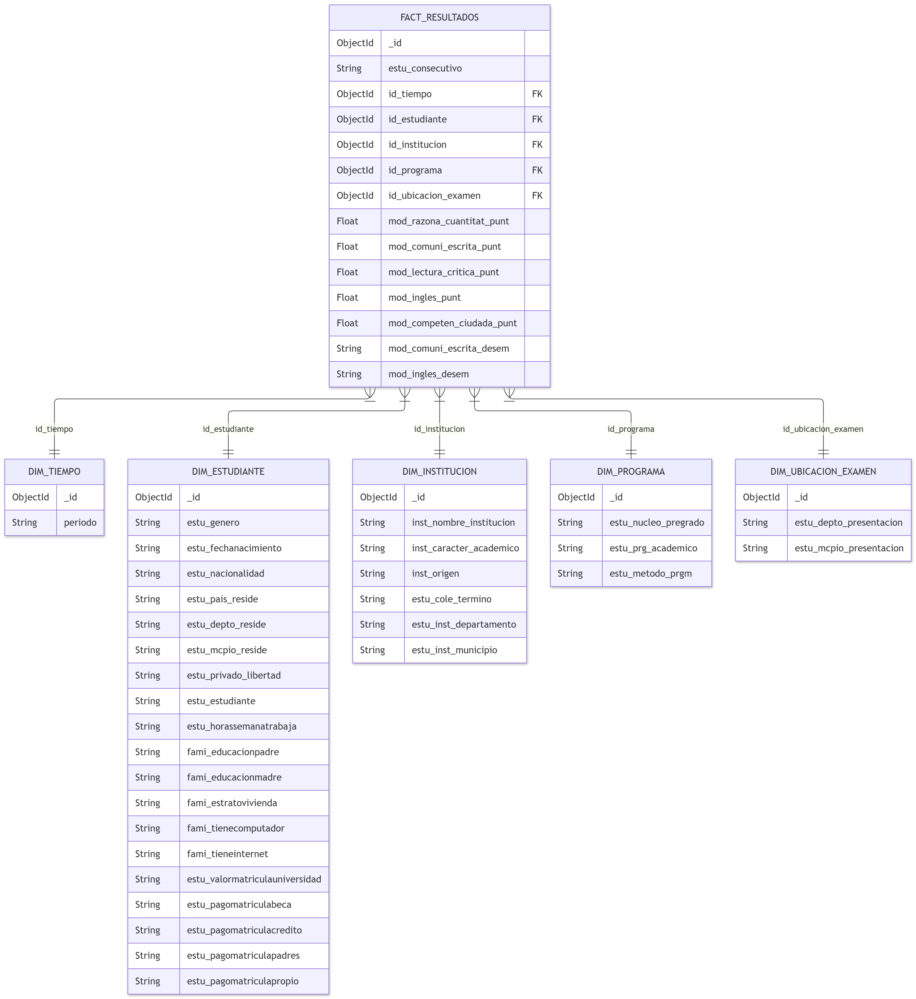

# proyecto-BI-pruebas-de-software
Proyecto final de pruebas de software que tiene como objetivo crear un proceso ETL para posteriormente presentar los resultados en un dashboard, facilitando la toma de decisiones.

## Stack tecnológico previsto

- Metodología de ciencia de datos: **CRISP-DM**.
- Base de datos: **MongoDB** como opción principal NoSQL. Apache Cassandra queda como alternativa para escenarios distribuidos de Big Data.
- Procesamiento y analítica: **Python**, pandas, NumPy, scikit-learn, XGBoost y LightGBM.
- Backend: **Python con FastAPI**.
- Frontend: **JavaScript/TypeScript, React y Vite**.
- Visualización: **Plotly, Chart.js o D3.js**.

## Frontend de autenticación (HU01)

La pantalla de acceso está implementada en `frontend/` con React, TypeScript,
Vite y la API de autenticación de FastAPI. Incluye guardas para `/dashboard`,
sesión persistida con expiración y menús/dashboards según el rol:
Administrador, Analista o Investigador.

```bash
cd frontend
npm install
npm run dev
```

En `frontend/.env.local`, define `VITE_API_URL` con la URL del backend
(por ejemplo, `http://127.0.0.1:8000`). El formulario siempre envía las
credenciales a `POST /api/auth/login`; no se conecta directamente a Neon Auth
ni deduce el rol a partir del correo. El backend debe tener
`FRONTEND_ORIGIN` configurado con el origen de Vite para permitir CORS.

Durante el desarrollo también puedes omitir `VITE_API_URL`: Vite redirige
`/api` mediante el proxy configurado en `frontend/vite.config.ts`. Nunca
expongas `DATABASE_URL` al frontend.

El backend expone `GET /api/health/neon`, que ejecuta `SELECT 1` contra
`DATABASE_URL` usando el driver `psycopg`. La URL agrupada (`DATABASE_URL`) es
la adecuada para las solicitudes web; reserva `DATABASE_URL_UNPOOLED` para
migraciones y tareas administrativas.

La migración [001_create_app_users.sql](./migrations/001_create_app_users.sql)
crea `app.users`, que relaciona cada usuario autenticado por Neon Auth con uno
de los roles de HU01 (`Administrador`, `Analista` o `Investigador`). Neon Auth
mantiene el correo, el hash de contraseña y las sesiones en `neon_auth`; la
aplicación no duplica esas credenciales. Para asignar un usuario después de
registrarlo en Neon Auth:

```sql
INSERT INTO app.users (id, email, role)
VALUES ('UUID_DEL_USUARIO_NEON', 'usuario@universidad.edu.co', 'Analista');
```

### API de autenticación

`POST /api/auth/login` recibe `email` y `password`, delega la validación de
credenciales a Neon Auth y exige que el usuario tenga un registro activo en
`app.users`. La respuesta contiene un JWT de aplicación firmado por el backend,
con `role`, `permissions` y vencimiento de ocho horas:

```json
{
  "email": "usuario@universidad.edu.co",
  "password": "********"
}
```

Las rutas de KPIs, filtros, predicción y salud de la base de datos exigen
`Authorization: Bearer <access_token>`. `GET /api/auth/me` valida el token y
`GET /api/auth/permissions` devuelve los permisos efectivos. Configura
`NEON_AUTH_BASE_URL`, `NEON_AUTH_JWKS_URL` y `APP_JWT_SECRET` con los valores
del proyecto Neon. El secreto de aplicación debe tener al menos 32 caracteres;
no lo incluyas en el repositorio.

Si se necesita conservar un proveedor de autenticación propio, también se
puede definir `VITE_API_URL` y exponer `POST /api/auth/login` con este contrato:

```json
{
  "email": "nombre@universidad.edu.co",
  "password": "••••••••"
}
```

La respuesta esperada es una sesión con `accessToken`, `tokenType`, `expiresAt`
(opcional, en milisegundos) y `user` con `id`, `name`, `email` y `role`.
Las peticiones protegidas pueden reutilizar `authHeaders()` para enviar
`Authorization: Bearer <token>`.

### Exportación gerencial del dashboard (HU29)

El dashboard permite descargar su vista activa como un reporte PDF desde el
botón **Exportar PDF**. La exportación incluye el título de la vista, el usuario
y rol de la sesión, los filtros activos y la fecha de generación.

La implementación se encuentra en `frontend/src/services/dashboardPdf.ts`.
`html2canvas` captura el contenido y `jsPDF` genera el documento en formato A4,
con paginación automática y pie de página. Las librerías se cargan únicamente al
solicitar la exportación para no aumentar la carga inicial de la aplicación.

## Configuración local

Se recomienda ejecutar Python dentro de un entorno virtual aislado.

### Windows PowerShell

```powershell
python -m venv .venv
.\.venv\Scripts\Activate.ps1
python -m pip install --upgrade pip
python -m pip install -r scripts/requirements.txt
python -m pip install -r notebooks/requirements.txt
python -m ipykernel install --user --name proyecto-bi --display-name "Proyecto BI"
```

Para abrir un terminal nuevo sin activar el entorno, los ejecutables se encuentran en:

```text
.venv\Scripts\python.exe
.venv\Scripts\jupyter.exe
```

## Estructura

```text
data/       Dataset fuente y datos procesados
notebooks/  Análisis exploratorio y prototipado
scripts/    ETL y carga hacia NoSQL
docs/       Documentación e imágenes
```

Documentación adicional:

- [7.8 Historias de usuario e iteraciones del proyecto](./docs/7.8-historias-de-usuario-e-iteraciones.md)

## Ejecutar el notebook

```powershell
.\.venv\Scripts\Activate.ps1
jupyter lab notebooks/resultados-saber-pro-analisis.ipynb
```

Seleccione el kernel `Proyecto BI`. La ruta al CSV desde el notebook es `../data/Resultados_Saber_Pro_20260927.csv`.

## Ejecutar la carga NoSQL

MongoDB debe estar disponible en una instancia local o remota. Con MongoDB local en el puerto predeterminado:

```powershell
.\.venv\Scripts\Activate.ps1
python scripts/populate_nosql.py --reset
```

Opciones principales:

```powershell
python scripts/populate_nosql.py `
  --mongo-uri "mongodb://localhost:27017/" `
  --database "SaberProDB" `
  --collection "Fact_Resultados" `
  --batch-size 10000 `
  --encoding auto `
  --reset
```

El parámetro `--encoding latin-1` puede utilizarse si la detección automática identifica caracteres incorrectamente. No use `--reset` si desea conservar los documentos existentes.

## Exportación filtrada (HU09)

La HU09 puede ejecutarse directamente con un script Python; no requiere que el backend web esté implementado.

Instale las dependencias del script:

```powershell
.\.venv\Scripts\Activate.ps1
python -m pip install -r scripts/requirements.txt
```

Ejemplo CSV con filtros actuales:

```powershell
python scripts/export_data.py `
  --format csv `
  --year 2018 `
  --department BOGOTA `
  --institution UNIVERSIDAD `
  --reference-group ADMINISTRACION `
  --limit 10000 `
  --offset 0 `
  --output exports/saber-pro-2018-bogota.csv
```

Ejemplo JSON:

```powershell
python scripts/export_data.py --format json --year 2018 --limit 10000 --output exports/saber-pro-2018.json
```

Exportación por lotes:

```powershell
python scripts/export_data.py --format csv --limit 10000 --offset 0 --output exports/batch-1.csv
python scripts/export_data.py --format csv --limit 10000 --offset 10000 --output exports/batch-2.csv
python scripts/export_data.py --format csv --limit 10000 --offset 20000 --output exports/batch-3.csv
```

Las funciones reutilizables están en `scripts/export_data.py`:

- `build_filter()`: transforma filtros de dashboard a consulta MongoDB.
- `count_filtered_records()`: obtiene el total coincidente.
- `iter_filtered_records()`: genera registros por lotes.
- `export_filtered_data()`: crea CSV o JSON.

Parámetros de conexión opcionales mediante variables de entorno: `MONGO_URI`, `MONGO_DATABASE` y `MONGO_COLLECTION`. `--limit` está limitado a 100.000 registros por ejecución y `--batch-size` controla cuántos registros se procesan simultáneamente.

### 7.6.3 Dimensiones y Tabla de Hechos (Estructura en MongoDB)

Para el diseño de la base de datos NoSQL en MongoDB, se ha optado por un **Esquema de Estrella (Star Schema)**. Las 39 columnas de interés seleccionadas en la fase ETL han sido distribuidas lógicamente para optimizar las consultas del dashboard, separando los datos cuantitativos (hechos) de los datos descriptivos (dimensiones).

**1. Colección de Hechos: `Fact_Resultados`**
Contiene las métricas cuantitativas del desempeño y las llaves de referencia.
*   `_id`: ObjectId (Autogenerado por MongoDB).
*   `estu_consecutivo`: Texto (Identificador único del examinando).
*   `id_tiempo`: ObjectId (FK -> Dim_Tiempo).
*   `id_estudiante`: ObjectId (FK -> Dim_Estudiante).
*   `id_institucion`: ObjectId (FK -> Dim_Institucion).
*   `id_programa`: ObjectId (FK -> Dim_Programa).
*   `id_ubicacion_examen`: ObjectId (FK -> Dim_Ubicacion_Examen).
*   `mod_razona_cuantitat_punt`: Numérico.
*   `mod_comuni_escrita_punt`: Numérico.
*   `mod_lectura_critica_punt`: Numérico.
*   `mod_ingles_punt`: Numérico.
*   `mod_competen_ciudada_punt`: Numérico.
*   `mod_comuni_escrita_desem`: Texto (Nivel de desempeño).
*   `mod_ingles_desem`: Texto (Nivel de desempeño).

**2. Colección Dimensión: `Dim_Tiempo`**
*   `_id`: ObjectId.
*   `periodo`: Texto (Ej. "20225", "20212").

**3. Colección Dimensión: `Dim_Estudiante`**
Agrupa la información sociodemográfica y socioeconómica del examinado.
*   `_id`: ObjectId.
*   `estu_genero`: Texto.
*   `estu_fechanacimiento`: Fecha/Texto.
*   `estu_nacionalidad`: Texto.
*   `estu_pais_reside`: Texto.
*   `estu_depto_reside`: Texto.
*   `estu_mcpio_reside`: Texto.
*   `estu_privado_libertad`: Texto.
*   `estu_estudiante`: Texto.
*   `estu_horassemanatrabaja`: Texto.
*   `fami_educacionpadre`: Texto.
*   `fami_educacionmadre`: Texto.
*   `fami_estratovivienda`: Texto.
*   `fami_tienecomputador`: Texto.
*   `fami_tieneinternet`: Texto.
*   `estu_valormatriculauniversidad`: Texto.
*   `estu_pagomatriculabeca`: Texto.
*   `estu_pagomatriculacredito`: Texto.
*   `estu_pagomatriculapadres`: Texto.
*   `estu_pagomatriculapropio`: Texto.

**4. Colección Dimensión: `Dim_Institucion`**
*   `_id`: ObjectId.
*   `inst_nombre_institucion`: Texto.
*   `inst_caracter_academico`: Texto.
*   `inst_origen`: Texto.
*   `estu_cole_termino`: Texto.
*   `estu_inst_departamento`: Texto.
*   `estu_inst_municipio`: Texto.

**5. Colección Dimensión: `Dim_Programa`**
*   `_id`: ObjectId.
*   `estu_nucleo_pregrado`: Texto.
*   `estu_prgm_academico`: Texto.
*   `estu_metodo_prgm`: Texto.

**6. Colección Dimensión: `Dim_Ubicacion_Examen`**
*   `_id`: ObjectId.
*   `estu_depto_presentacion`: Texto.
*   `estu_mcpio_presentacion`: Texto.

### 7.6.4 Diagrama de la Base de Datos

A continuación, se presenta el diagrama del Esquema de Estrella implementado para la base de datos en MongoDB:



*Figura X. Diagrama del Esquema de Estrella para la base de datos SaberProDB en MongoDB.*

# Capítulo 7. Sistema Implementado

## 7.7 Proceso ETL (Extract, Transform, Load)

### 7.7.3 Carga de Datos a la Base de Datos NoSQL (Rutina Tentativa)

Para la carga inicial del dataset depurado (con un volumen superior a 1.000.000 de registros) hacia el motor NoSQL seleccionado (MongoDB), se ha diseñado una rutina en Python que garantiza la integridad de los datos y el rendimiento del sistema. Dado el alto volumen de información, no se realiza una inserción registro por registro (lo cual saturaría la memoria y el tiempo de ejecución), sino que se implementa una **estrategia de carga por lotes (Batching)**.

**Flujo lógico de la rutina:**
1. **Extracción:** El script lee el archivo CSV depurado y homologado (que contiene los datos unificados de los 5 años) utilizando la librería `pandas`.
2. **Conexión:** Se establece la conexión con la base de datos MongoDB mediante la librería `pymongo`, apuntando al clúster local o en la nube y a la base de datos `SaberProDB`.
3. **Transformación a Documentos (BSON):** Los datos tabulares se convierten en diccionarios de Python (que MongoDB almacena internamente como BSON). Siguiendo el Esquema de Estrella definido, los registros se preparan para poblar la colección de Hechos (`Fact_Resultados`) y las colecciones de Dimensiones (`Dim_Estudiante`, `Dim_Institucion`, `Dim_Tiempo`, etc.).
4. **Carga por Lotes:** Para evitar el desbordamiento de la memoria RAM, el script recorre el DataFrame en bloques (chunks) de 10.000 registros. Cada bloque se inserta en MongoDB utilizando el método `insert_many()`.
5. **Verificación:** Al finalizar el ciclo, el script realiza un conteo de los documentos en cada colección para confirmar que la carga se completó exitosamente y que el número de documentos coincide con las filas del CSV.

---

### Pseudocódigo de la Rutina de Carga

```text
INICIO
  // 1. Definir conexión
  cliente = Conectar_MongoDB("mongodb://localhost:27017/")
  db = cliente["SaberProDB"]
  
  // 2. Leer el dataset depurado (CSV)
  datos = Leer_CSV("dataset_saber_pro_5_anios.csv")
  
  // 3. Definir tamaño del lote
  TAMANO_LOTE = 10000
  total_registros = Contar_Filas(datos)
  
  // 4. Ciclo de carga por lotes
  PARA i = 0 HASTA total_registros PASO TAMANO_LOTE HACER:
      lote_actual = datos[i : i + TAMANO_LOTE]
      lista_documentos = Convertir_A_JSON(lote_actual)
      
      // Insertar en la colección de hechos
      db["Fact_Resultados"].insert_many(lista_documentos)
      
      Imprimir("Insertados registros del " + i + " al " + (i + TAMANO_LOTE))
  FIN PARA
  
  // 5. Verificar
  conteo_final = db["Fact_Resultados"].count_documents({})
  Imprimir("Carga finalizada. Total en BD: " + conteo_final)
FIN
```

### Reporte post-ETL

El notebook `notebooks/resultados-saber-pro-analisis.ipynb` es la fuente
oficial de limpieza. Su última celda exporta el resultado a
`data/Resultados_Saber_Pro_limpio.csv` y genera `reports/post_etl_report.json`
con las filas leídas, limpias, descartadas y el detalle de los descartes.

Después de ejecutar el notebook, el cargador toma únicamente el CSV limpio:

```bash
python3 scripts/populate_nosql.py \
  --csv data/Resultados_Saber_Pro_limpio.csv
```

`scripts/populate_nosql.py` no repite la depuración; solo transforma cada fila
limpia al esquema estrella y la carga en MongoDB.

```python 
import pandas as pd 
from pymongo import MongoClient 

# 1. Conexión a MongoDB 
cliente = MongoClient("mongodb://localhost:27017/") 
db = cliente["SaberProDB"] 
coleccion_hechos = db["Fact_Resultados"] 

# 2. Lectura del dataset depurado 
df = pd.read_csv("dataset_saber_pro_5_anios.csv") 

# 3. Carga por lotes (Batching) para optimizar memoria 
TAMANO_LOTE = 10000 
total_registros = len(df) 

print(f"Iniciando carga de {total_registros} registros...") 

for i in range(0, total_registros, TAMANO_LOTE): 
	# Extraer el lote actual 
	lote = df.iloc[i:i+TAMANO_LOTE] 
	
	# Convertir el lote a una lista de diccionarios (formato BSON/JSON) 
	documentos = lote.to_dict(orient="records") 
	
	# Inserción masiva en la colección 
	coleccion_hechos.insert_many(documentos) 
	print(f"Insertados {i + len(lote)} de {total_registros registros...") 
	
# 4. Verificación final 
conteo_final = coleccion_hechos.count_documents({}) 
print(f"¡Carga completada! Total de documentos en la BD: {conteo_final}") 
```

---

# Backend API

La API REST desarrollada con **FastAPI** permite consultar la base de datos MongoDB `SaberProDB`, organizada con el Esquema de Estrella descrito anteriormente. El código se encuentra en la carpeta `backend/`.

## Requisitos previos

- **MongoDB** en ejecución local o remoto. Por defecto se utiliza `mongodb://localhost:27017/`.
- **Python 3.10 o superior**.
- Base de datos `SaberProDB` poblada con las colecciones del Esquema de Estrella: `Fact_Resultados`, `Dim_Tiempo`, `Dim_Estudiante`, `Dim_Institucion`, `Dim_Programa` y `Dim_Ubicacion_Examen`.
- Las variables de entorno `MONGO_URI` y `MONGO_DATABASE` configuradas en el archivo `.env`.

## Instalación y ejecución del Backend

```bash
cd backend
pip install -r requirements.txt
cp .env.example .env
uvicorn app.main:app --reload --env-file .env
```

El archivo `.env` debe contener las variables de conexión:

```dotenv
MONGO_URI=mongodb://localhost:27017/
MONGO_DATABASE=SaberProDB
```

La API quedará disponible en `http://localhost:8000`. Se recomienda crear y activar un entorno virtual antes de instalar las dependencias.

## Endpoints disponibles

### `GET /api/health`

Verifica que la API esté activa y que MongoDB responda correctamente.

**Respuesta exitosa:**

```json
{
  "status": "ok",
  "mongo": "connected"
}
```

Si MongoDB no está disponible, el endpoint devuelve HTTP `503` con el estado `disconnected`.

### `GET /api/kpis`

Calcula el promedio de una métrica numérica de `Fact_Resultados`. Por defecto utiliza `mod_razona_cuantitat_punt`. Todos los filtros son opcionales y se pueden combinar entre sí.

**Filtros disponibles:**

| Parámetro | Descripción |
| --- | --- |
| `periodo` | Periodo académico, por ejemplo `20225`. |
| `departamento` | Departamento de residencia del estudiante. |
| `municipio` | Municipio de residencia del estudiante. |
| `institucion` | Nombre de la institución de educación superior. |
| `caracter_institucion` | Carácter académico de la institución. |
| `programa` | Nombre del programa académico. |
| `metodo_programa` | Metodología del programa. |
| `genero` | Género del estudiante (`F` o `M`). |
| `estrato` | Estrato socioeconómico; acepta `2` o `Estrato 2`. |
| `grupo_referencia` | Núcleo de conocimiento o grupo de referencia. |
| `internet` | Tenencia de internet en el hogar (`true` o `false`). |
| `computador` | Tenencia de computador en el hogar (`true` o `false`). |
| `departamento_examen` | Departamento donde se presentó el examen. |
| `municipio_examen` | Municipio donde se presentó el examen. |
| `metrica` | Métrica numérica a promediar. Valor por defecto: `mod_razona_cuantitat_punt`. |

Los filtros de texto no distinguen entre mayúsculas y minúsculas.

**Ejemplo de consulta:**

```text
GET http://localhost:8000/api/kpis?periodo=20225&departamento=ANTIOQUIA&genero=F&internet=true
```

**Ejemplo de respuesta:**

```json
{
  "metric": "mod_razona_cuantitat_punt",
  "value": 150.42,
  "total_records": 1234,
  "filters": {
    "periodo": "20225",
    "departamento": "ANTIOQUIA",
    "genero": "F",
    "internet": true
  }
}
```

## Documentación interactiva

La documentación generada automáticamente por FastAPI está disponible en:

- **Swagger UI:** [http://localhost:8000/docs](http://localhost:8000/docs)
- **ReDoc:** [http://localhost:8000/redoc](http://localhost:8000/redoc)

## Historias de Usuario Implementadas

### HU-04: Visualización de Salud de la BD NoSQL

**Endpoint:** `GET /api/salud-bd`

Devuelve métricas de salud y rendimiento de MongoDB: estado de la conexión, cantidad de documentos por colección, tiempo de una consulta de agregación y espacio total ocupado por la base de datos.

**Ejemplo de respuesta real:**

```json
{
  "estado_conexion": "conectado",
  "colecciones": {
    "Fact_Resultados": 1209063,
    "Dim_Tiempo": 13,
    "Dim_Estudiante": 1209063,
    "Dim_Institucion": 267218,
    "Dim_Programa": 1322,
    "Dim_Ubicacion_Examen": 166
  },
  "tiempo_promedio_consulta_ms": 265.663,
  "espacio_total_mb": 591.08,
  "total_documentos": 2686845
}
```

La ejecución reportó **2.686.845 documentos** en total y **591 MB** de espacio ocupado. Si MongoDB no responde, el endpoint devuelve HTTP `503` con un mensaje descriptivo.

### HU-10: Mapeo de Filtros Multidimensionales

Cada endpoint devuelve la lista de valores únicos (`distinct`) de una dimensión, ordenados alfabéticamente y sin valores nulos o vacíos, para poblar los dropdowns del frontend.

**Endpoints disponibles:**

- `GET /api/filtros/periodos`
- `GET /api/filtros/departamentos`
- `GET /api/filtros/municipios`
- `GET /api/filtros/instituciones`
- `GET /api/filtros/caracteres`
- `GET /api/filtros/programas`
- `GET /api/filtros/metodos`
- `GET /api/filtros/generos`
- `GET /api/filtros/estratos`
- `GET /api/filtros/nucleos`

**Ejemplo de respuesta para `GET /api/filtros/periodos`:**

```json
{
  "valores": [
    "20183",
    "20184",
    "20194",
    "20195",
    "20196",
    "20202",
    "20203",
    "20212",
    "20213",
    "20222",
    "20223",
    "20225",
    "20226"
  ],
  "total": 13
}
```

### HU-11: KPI Promedio Global

**Endpoint:** `GET /api/kpis/global`

Devuelve el promedio del puntaje global, calculado como el promedio de los cinco módulos. Si se filtra por periodo, incluye el comparativo porcentual con el periodo inmediatamente anterior.

**Ejemplo de respuesta con `?periodo=20225`:**

```json
{
  "promedio_global": 145.6,
  "total_registros": 123537,
  "periodo_actual": "20225",
  "comparativo_porcentual": -7.61
}
```

### HU-12: KPIs Promedios por Competencia

**Endpoint:** `GET /api/kpis/competencias`

Devuelve en una sola consulta los promedios de razonamiento, lectura crítica, competencias ciudadanas, comunicación escrita e inglés, junto con el promedio global y el total de registros. Acepta los mismos filtros opcionales que `/api/kpis`.

**Ejemplo de respuesta sin filtros:**

```json
{
  "razonamiento": 146.76,
  "lectura": 149.4,
  "ciudadanas": 144.89,
  "escrita": 139.13,
  "ingles": 153.52,
  "promedio_global": 146.74,
  "total_registros": 1209063
}
```

### HU-20: Entrenamiento y Selección de Modelos Predictivos

**Script de entrenamiento:** `scripts/train_model.py`

**Modelo seleccionado:** XGBoost (mejor MAE y R² entre RandomForest, GradientBoosting y XGBoost).

**Resultados del entrenamiento:**

| Modelo | CV MAE | Test MAE | RMSE | R² |
|--------|--------|----------|------|-----|
| RandomForest | 18.13 | 18.12 | 23.10 | 0.179 |
| GradientBoosting | 17.19 | 17.19 | 21.87 | 0.264 |
| **XGBoost** | **17.02** | **17.01** | **21.69** | **0.276** |

**Muestra usada:** 200,000 registros aleatorios (198,760 utilizables).

**Variables más importantes:** caracter_academico_UNIVERSIDAD (24.7%), depto_institucion_CHOCO (9.8%), metodo_programa_PRESENCIAL (7.5%), depto_reside_BOGOTÁ (5.6%), estrato (2.2%).

**Interpretación del R² = 0.276:** Las variables socioeconómicas y de contexto explican aproximadamente el 28% de la varianza del puntaje global. Esto es coherente con la literatura (De La Hoz et al., 2026), que indica que los puntajes previos de Saber 11 son los predictores más fuertes, mientras que las variables socioeconómicas aportan información complementaria.

**Endpoint de predicción:** `POST /api/predecir`

- Recibe un JSON con las características del estudiante (genero, estrato, educacion_padre, educacion_madre, tiene_internet, tiene_computador, caracter_academico, metodo_programa, depto_reside, depto_institucion).
- Devuelve `puntaje_predicho` (float) y `nivel_desempeno` (Bajo/Medio/Alto/Muy Alto).
- Ejemplo de respuesta:

```json
{
  "puntaje_predicho": 153.64,
  "nivel_desempeno": "Alto",
  "confianza": null
}
```

### HU-30: Arquitectura con Patrones de Diseño

El backend implementa los siguientes patrones:

- **Singleton:** una única conexión a MongoDB compartida por toda la aplicación.
- **Builder:** construcción dinámica de pipelines de agregación con `$lookup` y filtros opcionales.

**Archivos clave:**

- `app/database.py`: implementación de `MongoConnection` como Singleton.
- `app/builders/query_builder.py`: implementación de `QueryBuilder` para construir consultas dinámicas.

### HU-05: Menú de navegación personalizado por rol

El frontend muestra una navegación diferente según el perfil autenticado:

- **Administrador:** resumen, usuarios y permisos, reportes gerenciales, datos y ETL, y estado de la plataforma.
- **Analista:** resumen, indicadores KPI, reportes analíticos y datos con filtros.
- **Investigador:** resumen, distribuciones, predicciones y reportes de estudio.

El menú conserva el estado visual activo, permite restaurar la vista desde el fragmento de la URL y se adapta a móviles mediante un panel lateral. El cierre de sesión permanece disponible desde el encabezado en escritorio y móvil.

**Archivos clave:**

- `frontend/src/App.tsx`: configuración central de opciones por rol, estado de navegación y cierre de sesión.
- `frontend/src/styles.css`: estilos del menú lateral, estados activos, panel móvil y accesibilidad visual.
