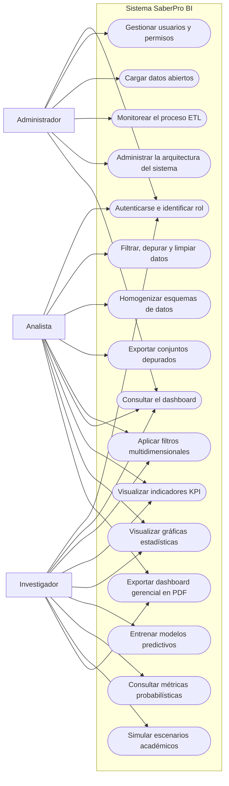

# 7.8 Historias de usuario e iteraciones del proyecto

## 7.8.1 Definición de historias de usuario

Las historias de usuario siguientes se obtuvieron del Project #5 **Historias de usuario** del repositorio y cubren los modulos del sistema. La numeracion corresponde al numero de historia definido en el tablero.

### HU01: Autenticación y Control de Acceso por Roles

**Issue:** #2  
**Estado en el Project:** In progress  

- Como: Usuario registrado (Administrador, Analista, Investigador).
- Quiero: Iniciar sesión con mi correo y contraseña a través de una pantalla de login segura.
- Para: Acceder a un menú dinámico adaptado a mis permisos y proteger la información del sistema.

Criterios de Aceptación:
1. Validar credenciales almacenadas en la base de datos.
2. Redireccionar al dashboard correspondiente según el rol asignado (MVC).
3. Denegar el acceso a rutas protegidas sin un token/sesión activo.

### HU02: Gestión de Usuarios y Permisos

**Issue:** #3  
**Estado en el Project:** Backlog  

- Como: Administrador.
- Quiero: Crear, editar y desactivar cuentas de usuario asignándoles uno de los 3 roles del sistema.
- Para: Garantizar el control jerárquico de acceso a las funcionalidades descriptivas y predictivas.

Criterios de Aceptación:
1. Panel CRUD para la administración de usuarios.
2. Asignación obligatoria de rol (Administrador, Analista o Investigador).
3. Inactivación inmediata de acceso al cambiar el estado del usuario.

### HU03: Carga de Datos Abiertos y Monitoreo del ETL

**Issue:** #4  
**Estado en el Project:** In review  

- Como: Administrador.
- Quiero: Ejecutar y visualizar el estado del proceso ETL sobre los archivos de Saber Pro (2018-2022).
- Para: Asegurar la homogenización de esquemas cambiantes de más de 1.000.000 de registros.

Criterios de aceptación:
1. Interfaz de consola/log del proceso de limpieza e ingesta.
2. Reporte de cantidad de registros depurados e insertados en NoSQL.
3. Muestra de alerta en caso de fallos en el esquema de importación de un año específico.

### HU04: Visualización de Salud de la BD NoSQL

**Issue:** #5  
**Estado en el Project:** In review  

- Como: Administrador.
- Quiero: Consultar las métricas de volumen de almacenamiento y latencia de la base de datos NoSQL (MongoDB/Cassandra).
- Para: Garantizar la disponibilidad y óptimo rendimiento del sistema ante consultas masivas de Big Data.

Criterios de Aceptación:
1. Indicador de total de filas procesadas (mínimo 1.000.000 de registros).
2. Tiempo promedio de respuesta de las consultas.

### HU05: Menú de Navegación Personalizado por Menú/Dashboard

**Issue:** #6  
**Estado en el Project:** In progress  

- Como: Usuario autenticado.
- Quiero: Visualizar un menú principal con las opciones exclusivas para mi rol.
- Para: Navegar de forma ágil e intuitiva entre los tableros analíticos y módulos administrativos.

Criterios de Aceptación:
1. Menú responsivo con las secciones habilitadas según el perfil.
2. Cierre de sesión seguro disponible en todo momento.

### HU06: Homogenización de Esquemas de Datos Heterogéneos

**Issue:** #7  
**Estado en el Project:** In review  

- Como: Administrador / Sistema.
- Quiero: Transformar y mapear columnas con nombres o tipos divergentes entre los años 2018 a 2022.
- Para: Generar una estructura unificada en la base de datos NoSQL apta para consultas consolidadas.

Criterios de Aceptación:

1. Estandarización de variables clave (INST_NOMBRE_INSTITUCION, MOD_RAZONAMIENTO_CUANTITATIVO_PUNT, FAMI_ESTRATOVIVIENDA, etc.).
2. Manejo consistente de valores nulos o campos obsoletos.

### HU07: Filtrado de Calidad y Limpieza de Atípicos

**Issue:** #8  
**Estado en el Project:** In review  

- Como: Administrador / Sistema.
- Quiero: Depurar registros duplicados, inconsistencias puntuales e inscripciones anómalas de las pruebas.
- Para: Evitar sesgos en las métricas estadísticas descriptivas y modelos de Machine Learning.

Criterios de Aceptación:
1. Descarte de registros sin puntajes genéricos o con identificadores inconsistentes.
2. Generación de un reporte sintético post-ETL con filas limpiadas.

### HU08: Almacenamiento Optimizado en Documentos/Colecciones NoSQL

**Issue:** #9  
**Estado en el Project:** In review  

- Como: Administrador / Sistema.
- Quiero: Indexar las variables más consultadas (año, departamento, institución, grupo de referencia) en NoSQL.
- Para: Responder a los 10 filtros dinámicos del dashboard en subsegundos. 

Criterios de Aceptación:
1. Estructura de documentos JSON/filas NoSQL optimizada.
2. Indexación de campos geográficos, institucionales y socioeconómicos.

### HU09: Exportación de Conjuntos Depurados

**Issue:** #10  
**Estado en el Project:** In review  

- Como: Investigador / Analista.
- Quiero: Exportar subconjuntos de datos filtrados en formato CSV/JSON.
- Para: Realizar validaciones externas o procesamientos estadísticos específicos.

Criterios de Aceptación:

1. Opción de descarga basada en la selección actual de filtros.
2. Límite de registros configurable o exportación por lotes.

### HU10: Mapeo de Filtros Multidimensionales

**Issue:** #11  
**Estado en el Project:** In review  

- Como: Analista Institucional.
- Quiero: Aplicar 10 filtros simultáneos (Año, Departamento, Municipio, Nombre IES, Carácter IES, Programa, Jornada, Género, Estrato Socioeconómico y Grupo de Referencia).
- Para: Segmentar el desempeño de los estudiantes según variables de interés institucional.

Criterios de Aceptación:
1. Presencia de los 10 controles de filtro interactivos en la interfaz.
2. Actualización en tiempo real de todas las métricas y gráficas al modificar cualquier filtro.

### HU11: Métrica KPI - Promedio Global Saber Pro

**Issue:** #12  
**Estado en el Project:** In review  

- Como: Analista Institucional.
- Quiero: Visualizar una tarjeta KPI con el promedio del puntaje global en Saber Pro.
- Para: Evaluar el nivel académico general del grupo seleccionado.

Criterios de Aceptación:
1. Cálculo dinámico del promedio del puntaje global conforme a los filtros activos.
2. Comparativo visual en porcentaje de variación respecto al período o filtro anterior.

### HU12: Métricas KPI - Promedios en Competencias Genéricas (5 tarjetas)

**Issue:** #13  
**Estado en el Project:** In review  

- Como: Analista Institucional.
- Quiero: Visualizar 5 tarjetas de métricas con el puntaje promedio de cada competencia genérica (Lectura Crítica, Razonamiento Cuantitativo, Competencias Ciudadanas, Comunicación Escrita e Inglés).
- Para: Identificar las competencias más fuertes y las de mayor falencia.

Criterios de Aceptación:
1. 5 métricas individuales expresadas numéricamente.
2. Indicador cualitativo (Aceptable, Deficiente, Sobresaliente) según escala estándar del ICFES.

### HU13: Métrica KPI - Distribución de Niveles de Desempeño en Inglés

**Issue:** #14  
**Estado en el Project:** Backlog  

- Como: Analista Institucional.
- Quiero: Consultar la métrica con la proporción de estudiantes en niveles de inglés (A-, A1, A2, B1, B+).
- Para: Medir la eficacia de los programas de bilingüismo en las IES.

Criterios de Aceptación:
1. Métrica con porcentaje de estudiantes en niveles B1/B+

### HU14: Métricas KPI - Total Evaluados e Índice de Cobertura Socioeconómica

**Issue:** #15  
**Estado en el Project:** Backlog  

- Como: Analista Institucional.
- Quiero: Ver el total de registros analizados y el porcentaje de estudiantes pertenecientes a estratos 1 y 2.
- Para: Comprender la magnitud de la muestra y el nivel de inclusión social de la cohorte seleccionada.

Criterios de Aceptación:
1. Métrica de volumen total de evaluados bajo los filtros.
2. Métrica de porcentaje de vulnerabilidad socioeconómica.

### HU15: Gráfica Estadística 1 - Histórico de Puntaje Global (2018-2022)

**Issue:** #16  
**Estado en el Project:** Backlog  

- Como: Analista Institucional.
- Quiero: Visualizar un gráfico de líneas con la evolución del puntaje global medio a lo largo de los 5 años.
- Para: Analizar la tendencia temporal del desempeño institucional.
Criterios de Aceptación:

1. Gráfica de líneas temporal interconectada con los 10 filtros.
2. Tooltip interactivo mostrando el puntaje por cada año.

### HU16: Gráfica Estadística 2 - Comparativo de Competencias por Grupo de Referencia

**Issue:** #17  
**Estado en el Project:** Backlog  

- Como: Analista Institucional.
- Quiero: Visualizar un gráfico de barras radial (o diagrama de araña/radar) comparando las 5 competencias genéricas entre la IES seleccionada y el grupo de referencia nacional.
- Para: Detectar brechas académicas relativas frente al estándar del área del conocimiento.

- Criterios de Aceptación:
1. Diagrama comparativo multitrazado.
2. Leyenda clara diferenciando el valor institucional vs. el promedio nacional.

### HU17: Gráfica Estadística 3 - Desempeño Académico por Estrato Socioeconómico

**Issue:** #18  
**Estado en el Project:** Backlog  

- Como: Analista Institucional.
- Quiero: Visualizar un gráfico de cajas y bigotes (o barras agrupadas) del puntaje global desglosado por estrato socioeconómico (Estratos 1 al 6).
- Para: Analizar el impacto de la brecha socioeconómica en los resultados de aprendizaje.

Criterios de Aceptación:
1. Gráfica estadística mostrando mediana, desviaciones o promedios por estrato.

### HU18: Gráfica Estadística 4 - Distribución Geográfica de Resultados por Departamento

**Issue:** #19  
**Estado en el Project:** Backlog  

- Como: Analista Institucional.
- Quiero: Visualizar un mapa de calor geográfico de Colombia resaltando el puntaje promedio por departamento.
- Para: Identificar disparidades territoriales en la calidad de la educación superior. 

Criterios de Aceptación:
1. Mapa interactivo codificado por colores según la escala de puntaje.
2. Filtro de detalle que permite hacer zoom o seleccionar un departamento.

### HU19: Gráfica Estadística 5 - Distribución por Tipo de Calificación e Institución (Top/Bottom IES)

**Issue:** #20  
**Estado en el Project:** Backlog  

- Como: Analista Institucional.
- Quiero: Visualizar un gráfico de barras horizontales con el ranking del Top 10 y Bottom 10 de IES o programas en el contexto seleccionado.
- Para: Posicionar a la institución dentro del marco competitivo regional/nacional. 

Criterios de Aceptación:
1. Ranking gráfico ordenado de forma descendente.
2. Alternancia entre visualización por IES Oficiales y No Oficiales.

### HU20: Entrenamiento y Selección de Modelos Predictivos

**Issue:** #21  
**Estado en el Project:** In review  

- Como: Investigador / Toma de Decisiones.
- Quiero: Acceder a un módulo que entrene o ejecute modelos de Machine Learning (ej. Scikit-Learn/XGBoost) sobre las variables socioeconómicas y académicas.
- Para: Predecir el rango de desempeño futuro de los evaluados y descubrir variables de mayor ponderación.

Criterios de Aceptación:
1. Integración de librerías de ML en el backend (Python).
2. Métricas de validación del modelo disponibles (ej. R^2, RMSE, Precisión).

### HU21: Métrica Probabilística 1 - Probabilidad de Superar la Media Nacional

**Issue:** #22  
**Estado en el Project:** Backlog  

- Como: Investigador / Toma de Decisiones.
- Quiero: Consultar la probabilidad estimada (%) de que una cohorte con un perfil determinado supere la media nacional en Saber Pro.
- Para: Diseñar planes preventivos de refuerzo pedagógico antes de las pruebas.

Criterios de Aceptación:
1. Métrica porcentual resultante de la inferencia del modelo probabilístico.

### HU22: Métrica Probabilística 2 - Nivel de Riesgo Bajo Desempeño

**Issue:** #23  
**Estado en el Project:** Backlog  

- Como: Investigador / Toma de Decisiones.
- Quiero: Visualizar el índice o porcentaje predicho de estudiantes en riesgo de obtener puntajes en el quintil inferior.
- Para: Focalizar recursos de tutorías académicas institucionales. 

Criterios de Aceptación:
1. Métrica cuantitativa de riesgo académico alto/medio/bajo.

### HU23: Métrica Probabilística 3 - Impacto Estimado de Variables Clave (Feature Importance Score)

**Issue:** #24  
**Estado en el Project:** Backlog  

- Como: Investigador / Toma de Decisiones.
- Quiero: Visualizar la métrica del factor con mayor peso predictivo sobre el puntaje (ej. Educación del padre/madre, acceso a internet, estrato).
- Para: Sustentar políticas públicas o institucionales basadas en datos. 

Criterios de Aceptación:
1. Métrica con el valor numérico del coeficiente/importancia de la variable más determinante.

### HU24: Métrica Probabilística 4 - Puntuación Global Proyectada a Próximo Período

**Issue:** #25  
**Estado en el Project:** Backlog  

- Como: Investigador / Toma de Decisiones.
- Quiero: Ver el valor medio del puntaje global estimado para el siguiente ciclo académico.
- Para: Proyectar metas institucionales de acreditación de alta calidad.

Criterios de Aceptación:
1. Métrica con la estimación puntual del puntaje proyectado con intervalo de confianza.

### HU25: Métrica Probabilística 5 - Tasa de Crecimiento/Declive Proyectada

**Issue:** #26  
**Estado en el Project:** Backlog  

- Como: Investigador / Toma de Decisiones.
- Quiero: Consultar la tasa porcentual esperada de cambio en el rendimiento académico.
- Para: Alertar tempranamente sobre posibles deterioros en la calidad educativa.

Criterios de Aceptación:
1. Métrica de variación esperada expresada en porcentaje (positivo/negativo).

### HU26: Gráfica Probabilística 1 - Proyección de Progresión Temporal de Puntajes

**Issue:** #27  
**Estado en el Project:** Backlog  

- Como: Investigador / Toma de Decisiones.
- Quiero: Visualizar una gráfica de líneas que extienda el histórico (2018-2022) hacia una proyección de escenarios futuros (2023-2025).
- Para: Anticipar tendencias de rendimiento y tomar decisiones estratégicas de largo plazo.

Criterios de Aceptación:
1. Gráfica con línea histórica continua y línea de proyección discontinua con margen de error (área sombreada).

### HU27: Gráfica Probabilística 2 - Simulación de Escenarios "What-If"

**Issue:** #28  
**Estado en el Project:** Backlog  

- Como: Investigador / Toma de Decisiones.
- Quiero: Interactuar con una gráfica de dispersión o barras que re-calcule los puntajes esperados al modificar factores simulados (ej. Aumentar acceso a computador/internet en un 30%).
- Para: Evaluar el beneficio potencial de inversiones socioeducativas.

Criterios de Aceptación:
1. Controles tipo deslizador para ajustar parámetros de entrada del modelo.
2. Actualización dinámica del gráfico probabilístico simulado.

### HU28: Gráfica Probabilística 3 - Matriz de Importancia de Variables en Machine Learning

**Issue:** #29  
**Estado en el Project:** Backlog  

- Como: Investigador / Toma de Decisiones.   
- Quiero: Visualizar un gráfico de barras horizontales con el ranking de importancia de características (Feature Importances) del modelo predictivo.
- Para: Entender con claridad qué condicionantes sociodemográficos y académicos impactan más en Saber Pro.

Criterios de Aceptación:
1. Gráfica representativa con las variables ordenadas por su peso en el algoritmo de ML.

### HU29: Exportación Gerencial de Dashboards en PDF

**Issue:** #30  
**Estado en el Project:** In progress  

- Como: Analista / Investigador.
- Quiero: Generar y descargar un reporte gerencial consolidado en PDF con la vista actual del dashboard (filtros, KPI y gráficas).
- Para: Presentar los hallazgos en comités rectorales o reuniones de acreditación.

Criterios de Aceptación:

1. Botón de exportación que capture los componentes activos del cuadro de mando.   
2. Formato maquetado limpio orientado a la toma de decisiones gerenciales.

### HU30: Implementación de Arquitectura Modular con Patrones de Diseño (MVC, Builder, Singleton)

**Issue:** #31  
**Estado en el Project:** In review  

- Como: Administrador / Equipo Desarrollador.
- Quiero: Implementar la arquitectura del sistema respetando los patrones de diseño MVC, Builder y Singleton.
- Para: Asegurar la mantenibilidad, escalabilidad y desacoplamiento en el procesamiento de más de 1.000.000 de registros. 

Criterios de Aceptación:
1. MVC: Separación estricta entre modelos NoSQL, vistas en el dashboard y controladores de negocio.
2. Singleton: Uso de instancia única para la conexión con el motor SGBD NoSQL.
3. Builder: Patrón para la construcción modular de consultas dinámicas compuestas por los 10 filtros.

## 7.8.2 Iteraciones del proyecto

El Project no registra fechas ni un campo de iteracion o sprint. Por esta razon, la tabla siguiente presenta una organizacion propuesta por entregas funcionales. Agrupa las historias existentes sin modificar su contenido ni agregar historias externas. Cada iteracion tiene una duracion propuesta de dos semanas.

| Iteracion | Duracion | Historias incluidas | Entregable principal |
|---|---:|---|---|
| 1. Base de acceso y navegacion | 2 semanas | HU01-HU02, HU05 | Autenticacion, usuarios, permisos y menu segun rol |
| 2. Ingesta y preparacion de datos | 2 semanas | HU03-HU09 | Carga abierta, ETL, limpieza, esquemas, MongoDB y exportacion depurada |
| 3. Salud operacional y filtros | 2 semanas | HU04, HU10 | Monitoreo de MongoDB y filtros multidimensionales |
| 4. Indicadores estadisticos | 2 semanas | HU11-HU19 | KPIs y graficas estadisticas |
| 5. Prediccion y analitica probabilistica | 2 semanas | HU20-HU28 | Entrenamiento predictivo, probabilidades, proyecciones y simulaciones |
| 6. Exportacion y arquitectura final | 2 semanas | HU29-HU30 | PDF gerencial y arquitectura modular consolidada |

**Duracion total propuesta:** 12 semanas, distribuidas en 6 iteraciones de 2 semanas.

## 7.9 Requerimientos no funcionales

Los siguientes requerimientos describen las características técnicas, operativas y de calidad esperadas para la plataforma SaberPro BI. Algunos valores corresponden a metas propuestas que deben validarse durante las pruebas finales del sistema.

| No. Req | Atributo | Descripción |
|---|---|---|
| 1 | Plataforma de software | El sistema debe funcionar en equipos con Windows 10 o superior. El servidor de aplicación debe utilizar Python 3.10 o superior y el frontend debe ser compatible con navegadores actuales como Google Chrome, Microsoft Edge o Mozilla Firefox. |
| 2 | Plataforma de hardware para el servidor | Equipo de cómputo recomendado para ejecutar el backend, las bases de datos y las herramientas de análisis: - Procesador de 4 núcleos o superior. - Memoria RAM mínima de 8 GB; 16 GB recomendados. - Disco SSD de al menos 20 GB disponibles. - Conexión de red estable para la carga inicial de datos y el acceso remoto. |
| 3 | Plataforma de hardware para el cliente | Computador o dispositivo con capacidad para navegar en aplicaciones web: - Procesador de 2 núcleos o superior. - Memoria RAM mínima de 4 GB. - Resolución de pantalla mínima recomendada de 1366 × 768 píxeles. - Conexión a internet para acceder al frontend y a los servicios de autenticación. |
| 4 | Rendimiento | Las consultas e indicadores utilizados en el dashboard deben responder en un tiempo máximo aproximado de 3 segundos después de aplicada una consulta o filtro, considerando operaciones sobre el conjunto depurado disponible en MongoDB. |
| 5 | Disponibilidad | La aplicación debe ofrecer una disponibilidad objetivo del 99 % durante el horario de uso académico, permitiendo únicamente las ventanas programadas de mantenimiento o actualización. |
| 6 | Escalabilidad | La arquitectura debe permitir procesar, consultar y almacenar más de 1.000.000 de registros, y debe admitir crecimiento futuro mediante servicios independientes, carga por lotes y estructuras de datos escalables. |
| 7 | Seguridad | Las operaciones administrativas deben requerir autenticación y los permisos deben limitar las funciones según el rol Administrador, Analista o Investigador. Las variables de conexión, credenciales y secretos no deben almacenarse ni exponerse en el código fuente o en variables públicas del frontend. |
| 8 | Integridad de datos | Los procesos ETL deben evitar duplicados, conservar los registros válidos e informar las filas descartadas, los campos faltantes y los resultados de cada etapa de carga. |
| 9 | Usabilidad | La interfaz debe conservar una jerarquía visual consistente, mensajes claros, navegación por roles y controles accesibles por teclado. Las acciones principales deben ser comprensibles sin documentación adicional. |
| 10 | Compatibilidad visual | El frontend debe adaptarse correctamente a equipos de escritorio, tablets y teléfonos móviles, conservando legibles los filtros, las gráficas, las tablas y los botones principales. |
| 11 | Mantenibilidad | El código debe estar organizado por responsabilidades, separando frontend, servicios y backend, y debe seguir convenciones consistentes para facilitar correcciones, pruebas y nuevas historias de usuario. |
| 12 | Portabilidad | El backend debe poder ejecutarse en Windows o en otro entorno compatible con Python y las variables de configuración deben permitir cambiar entre conexiones locales y remotas de MongoDB sin modificar el código. |
| 13 | Interoperabilidad | Los servicios deben comunicarse mediante API REST y respuestas JSON. El sistema debe permitir cargar archivos CSV y exportar información o reportes PDF a través de formatos reconocidos por las herramientas de oficina. |
| 14 | Fiabilidad | Los errores de conexión con MongoDB, Neon u otros servicios deben ser informados de forma clara, sin causar pérdida silenciosa de datos ni bloquear completamente las vistas disponibles. |
| 15 | Privacidad y trazabilidad | El sistema debe registrar las operaciones relevantes de carga, autenticación y exportación cuando corresponda, evitando mostrar datos sensibles y aplicando control de acceso a la información académica. |
| 16 | Tiempo de recuperación | Después de una interrupción causada por una desconexión o falla del servicio, el sistema debe permitir restablecer la operación sin volver a cargar manualmente los datos, mediante reconexión automática o procedimientos documentados de reinicio. |

## 7.10 Diagrama de casos de uso del cliente

El diagrama representa las principales acciones que los usuarios pueden realizar dentro de la plataforma SaberPro BI. Los actores corresponden a los perfiles definidos en las historias de usuario, y cada caso de uso expresa una función accesible para el sistema.

- **Administrador:** administra usuarios, permisos, datos, monitoreo y configuración general del sistema.
- **Analista:** prepara los datos, consulta los indicadores y gráficas, aplica filtros y genera reportes.
- **Investigador:** analiza los resultados, consulta métricas probabilísticas, construye modelos y realiza simulaciones.